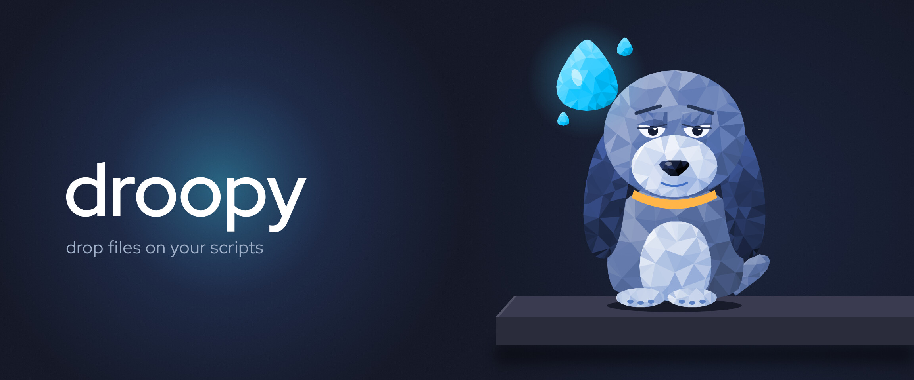
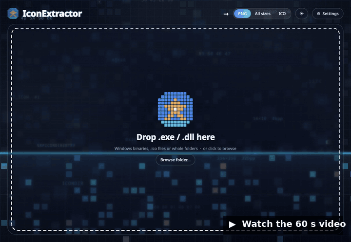
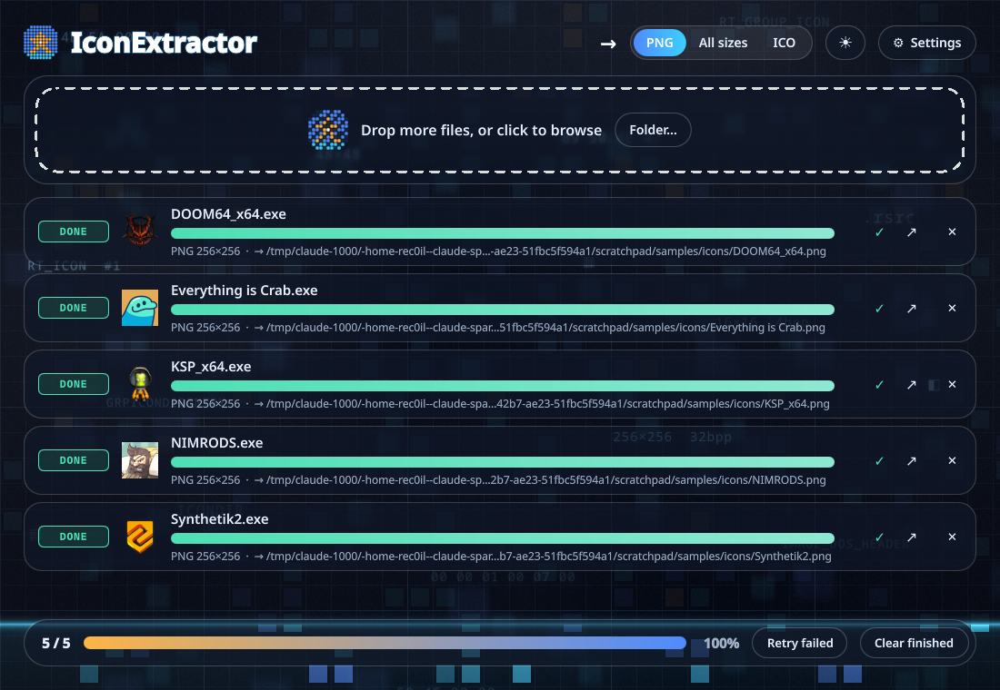
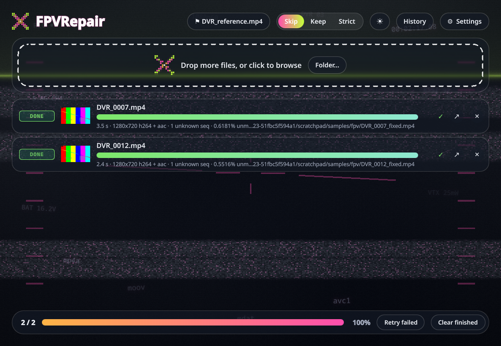
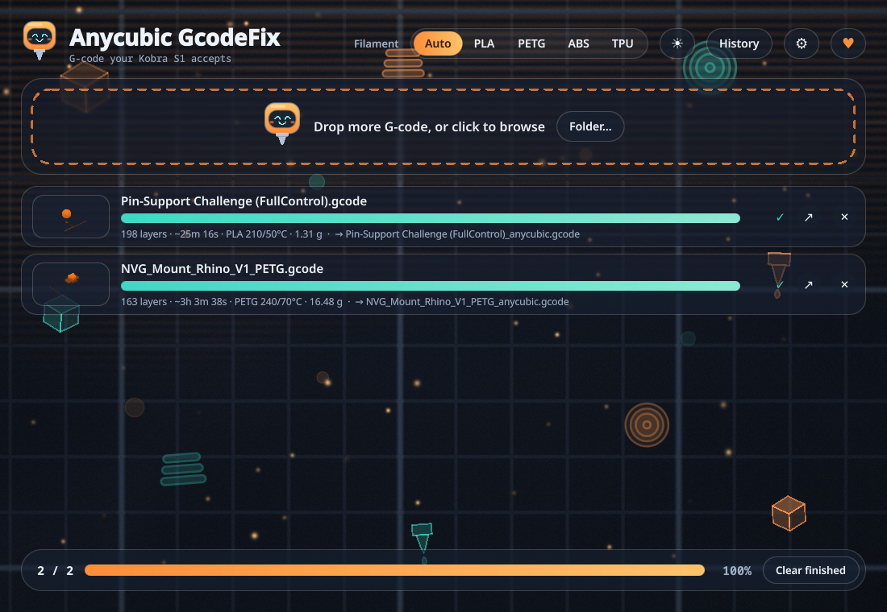
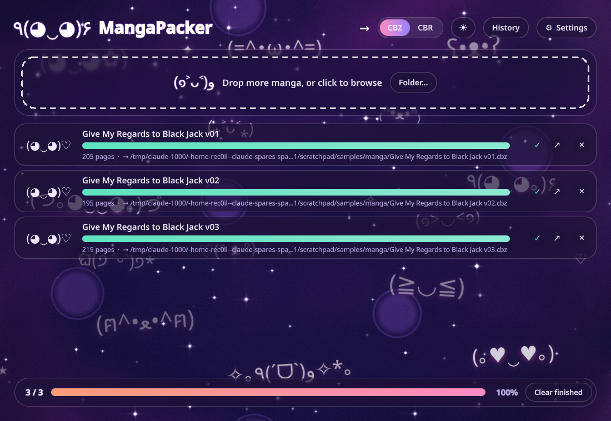

<p align="center">
  
</p>

<h3 align="center">Turn any script into a drag &amp; drop desktop app. One slash command, a few radio questions.</h3>

<p align="center">
  <a href="https://claude.com/claude-code"></a>
  <a href="#requirements"></a>
  <a href="#requirements"></a>
  <a href="#requirements"></a>
  <a href="LICENSE"></a>
</p>

---

You wrote a script. It works. Nobody is dropping a file on that.

**droopy** is a [Claude Code](https://claude.com/claude-code) skill. Point it at a Python script or any
command-line tool that works on files, answer a handful of radio questions, and you get a *droplet*: a
small Linux desktop app you drag files or folders onto. Every option the script has becomes a setting.
It installs, shows up in the app menu and in "Open with", keeps a CLI, and gets an animated background
designed for what it does.

<p align="center">
  <a href="https://www.youtube.com/watch?v=ju4Q0fNtGKg">
    
  </a>
  <br>
  <sub>▶ <a href="https://www.youtube.com/watch?v=ju4Q0fNtGKg">Watch the 60-second video</a>: a script becomes a droplet, and three more droplets built the same way.</sub>
</p>

## Quick start

```bash
git clone https://github.com/Rec0iL/droopy ~/.claude/skills/droopy
```

Then, inside Claude Code:

```
/droopy my_script.py
```

That's it. droopy reads the script, proposes what to expose, asks, builds, tests, screenshots and
tells you how to install.

| Mode | What happens |
|---|---|
| `/droopy <script>` | Step-by-step interview: inputs, options, extras, placement, look |
| `/droopy <script> --quick` | droopy decides everything, asks only about the look |
| `/droopy <script> --plan` | One plan to approve, then it builds |
| `/droopy update <folder>` | Refreshes the scaffold of a generated droplet, keeps your hand edits |

## How the interview goes

Every question is a radio question with a recommended answer first. Five rounds:

1. **Inputs & outputs** — which extensions, whether folders count, what one job is, where output goes.
2. **Options** — a table of every option the script has, each with a proposed control and placement:

   | option | control | place |
   |---|---|---|
   | Size mode | Segmented | header |
   | Every icon group | Switch | settings |
   | If output exists | Segmented | settings |

   Accept as proposed, move more to the header, or pin some as fixed.
3. **Extras** — retry failed, result previews, history, delete original (to trash), "Open with" MIME
   types, desktop notification, custom output naming.
4. **Placement & name** — app name, where the folder goes, install now or later.
5. **Look** — two or three background concepts tied to the purpose, mascot style, palette mood.

## What every droplet gets

| | |
|---|---|
| 🪟 **Drop zone + job queue** | One row per file, progress, status chips, reveal in file manager |
| ⚙️ **Settings dialog** | Every exposed option, theme (auto / light / dark), low-power mode |
| 📦 **`install.sh`** | Per-user or system-wide: menu entry, icon, `<app>` command, `uninstall.sh --purge` |
| 🖱️ **"Open with"** | MIME types registered, so the droplet appears in the file manager |
| ⌨️ **A CLI that still works** | `python3 -m <pkg>.core file…`: the core module has no Qt in it |
| 🎨 **A background made for its purpose** | A compiled GLSL shader (QML fallback without `qsb-qt6`) |
| 🧪 **Tests + smoke + screenshot** | Real cases for the script's behaviour, headless run, real-display grab |
| 🔁 **`droopy.json`** | The choices, so `/droopy update` can refresh the scaffold later |

## Droplets built this way

| | |
|---|---|
|  |  |
| **IconExtractor** — `.exe` / `.dll` in, PNG or ICO out. Resource-scanner background. | **FPVRepair** — the first droplet the skill generated. Wraps `untrunc`; every flag became a switch. |
|  |  |
| **Anycubic GcodeFix** — G-code your Kobra S1 accepts, from any slicer. | **MangaPacker** — folders & archives → CBZ / CBR. The one that started the style. |

IconExtractor, GcodeFix and MangaPacker were hand-built first; their shared structure became the
template. FPVRepair came out of the skill.

## Python or anything else

- **Python scripts** are imported natively: the logic is ported into `core.process()` and tested
  against the original behaviour.
- **Everything else** (`ffmpeg`, `untrunc`, a Go binary, a shell script) is wrapped: droopy parses
  `--help`, runs the tool as a subprocess and reads progress from its output (`NN%`, `x/y`).
- A script that reads stdin, runs a server or takes no paths is not droppable yet. droopy offers to
  adapt it first (add a path-taking entry point) and only touches the original if you agree.

## Generated layout

```
<AppName>/
  main.py  install.sh  uninstall.sh  README.md  requirements.txt  droopy.json
  <app_id>/   core.py (the ported logic, no Qt)  backend.py  worker.py  settings.py  runner.py  app.py
  qml/        Main, DropZone, JobCard, SettingsDialog, Theme, Background (+ History/Delete dialogs when chosen)
  shaders/    bg.frag + compiled bg.frag.qsb
  packaging/  <app_id>.svg
  tests/      test_core.py
```

Hand edits survive `update`: `core.py`, the shader, the icon, README and tests are protected files,
and the option rows, header toggles, palette and glyph regions are protected regions.

## Requirements

On the machine that runs the generated apps:

- Python 3.10+ and PySide6 with Qt Quick (Fedora/Nobara: `sudo dnf install python3-pyside6`)
- `qsb-qt6` for compiled shader backgrounds, optional (a QML-only background is used otherwise)
- Whatever the script itself needs; `install.sh` checks the tools a wrapped droplet depends on

## Skill layout

| Path | Purpose |
|---|---|
| `SKILL.md` | the skill: phases, rules, modes |
| `references/` | interview rounds, option-to-control mapping, core contract, wrapping non-Python tools, look design, verification, manifest schema |
| `template/` | the droplet scaffold with `droopy:feature` markers and protected regions |
| `tools/scaffold.py` | renders the template from `droopy.json`, strips unused features, compiles the shader; `--update` keeps hand edits |
| `tools/analyze.py` | static look at a script (argparse, constants, extensions, deps) or a tool's `--help` |
| `tools/droplet_check.py` | offscreen smoke test and real-display screenshot of a droplet |
| `docs/images/make_banner.py` | generates the low-poly banner and mascot |

## Why "droopy"

Named after the comic-strip dog, and a spin on *drop* / *droplet*. The mascot is an original low-poly
hound with the longest ears we could fit on a slab.

## License

MIT
